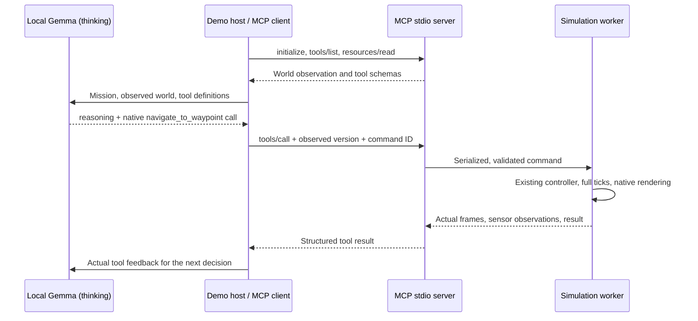

# Local Gemma controls an IR-SIM robot through MCP

[中文](README.zh-CN.md) · [Architecture and consistency](architecture.md) · [Performance evidence](https://github.com/hanruihua/ir-sim/pull/386)

This optional integration is a real Model Context Protocol server and a small local model host. The host connects through the official Python MCP client, discovers tools, reads observations, sends the mission to Gemma with thinking enabled, and forwards Gemma's native tool calls to the simulator. The simulator's existing controller executes bounded motion and returns actual observations.

The example visits blue and then green around a static obstacle. The pale grey rectangle labelled **Obstacle / no entry** is intentional collision geometry, not a rendering defect. The original default black fill was replaced to make its purpose clear.

## Install and run

From a checkout containing this change:

```powershell
uv sync --locked --extra mcp --group test --group lint
.\.venv\Scripts\python.exe usage/27mcp_robot/demo.py --display --realtime --record-window --output artifacts/mcp-demo/my-run
```

The demo expects a local OpenAI-compatible endpoint at `http://127.0.0.1:8000/v1`, serving `gemma-4-e2b-it`. This protocol compatibility does not use OpenAI's hosted API or require an OpenAI key. Override `--base-url` and `--model`, or set `IRSIM_GEMMA_URL` and `IRSIM_GEMMA_MODEL`. Optional authentication is read from `IRSIM_GEMMA_API_KEY`; never place credentials in the URL.

The validated server was the machine's existing Gemma 4 E2B model on vLLM 0.22.1. Its original configuration did not enable native tools. The demo used a temporary container with these extra server flags:

```text
--enable-auto-tool-choice --tool-call-parser gemma4 --reasoning-parser gemma4
```

These are server startup options, not fields that the client can enable. Use the parser names supported by the installed server. This host requires native `tool_calls` and a parsed `reasoning` or `reasoning_content` field. It sends `chat_template_kwargs: {enable_thinking: true}` on every model request. A token-limit response, missing tool call, multiple simultaneous calls or unsupported tool produces a failed run; it never silently switches off thinking or substitutes a scripted route. See [Gemma thinking](https://ai.google.dev/gemma/docs/capabilities/thinking) and [vLLM tool calling](https://docs.vllm.ai/en/latest/features/tool_calling/).

The visible demo uses Matplotlib's TkAgg backend and needs a graphical desktop and Tk. `--record-window` uses the bundled ffmpeg Windows `gdigrab` input, captures only the uniquely titled simulation window and verifies that the finalized MP4 decodes. It also extracts a final screenshot. This option currently supports Windows; headless MCP/model runs work without the capture option. Close other copies of the example before starting a recording. The native render, lidar and trajectory all come from IR-SIM. The video includes real model waiting time.

The checked-in recording, screenshot and portable verification report are in [the example assets](../../usage/27mcp_robot/assets/). Local runs produce `report.json`, `trace.jsonl`, model responses, the MCP handshake/tool schemas and stderr logs under the selected output directory. Those scratch artifacts are ignored by Git. No model weights or credentials are committed.

## What controls the robot



Gemma chooses the waypoint and its order. The host adds only the version from the observation and a unique command ID. `navigate_to_waypoint` uses the existing dash controller for the high-frequency loop. A model response that takes tens of seconds cannot serve as a 10 Hz velocity controller. Named waypoints come from YAML, not a hard-coded host route. `--expect blue green` is an independent test oracle and termination condition, not an instruction generator.

For example, try a different task:

```powershell
.\.venv\Scripts\python.exe usage/27mcp_robot/demo.py --mission "Visit orange, then green." --expect orange green --output artifacts/mcp-demo/orange-green
```

Navigation checks a buffered straight segment against obstacle geometry and rejects a blocked segment before setting the goal. It is not a global path planner or a guarantee for moving obstacles, curved vehicle trajectories or real hardware. The demo is validated with one planar omni robot, static geometry, dash control and lidar2d.

## Connect another MCP host

After installing the checkout, a typical local host configuration is:

```json
{
  "mcpServers": {
    "irsim": {
      "command": "C:/path/to/ir-sim/.venv/Scripts/python.exe",
      "args": [
        "-m", "irsim_mcp.server",
        "--world", "C:/path/to/ir-sim/usage/27mcp_robot/robot.yaml",
        "--allow-control", "--display"
      ]
    }
  }
}
```

Replace both paths with absolute paths. Remove `--allow-control` for read-only operation; mutation tools are then absent from discovery and the runtime also rejects writes. Remove `--display` to run without a figure. The transport is local stdio: the host starts the process and owns its lifecycle. This change does not expose an HTTP endpoint or attach to an arbitrary pre-existing Python environment.

| MCP surface | Behavior |
| --- | --- |
| `irsim://world/latest` resource | JSON copy of the latest available complete tick or completed command |
| `get_world_state()` | Same observation as structured tool output |
| `set_robot_goal(robot_id, x, y, expected_version, command_id)` | Set a finite, bounded goal without advancing time |
| `step_simulation(steps, expected_version, command_id)` | Advance 1–200 ticks; stop on collision or cancellation |
| `navigate_to_waypoint(robot_id, waypoint, max_steps, expected_version, command_id)` | Bounded existing controller, maximum 200 ticks |
| `reset_simulation(expected_version, command_id)` | Reset poses/time and increment the epoch |
| `cancel_motion()` | Request stopping at a complete tick boundary; the running command reports the actual stop frame |

The observation contains schema/session/epoch/revision/version, publication sequence, frame, simulation time, capture time/age, command-in-progress status, robot poses/velocities/goals/status, lidar ranges **and per-beam valid flags**, obstacle bounds, named waypoints and completed visits. Invalid/missing lidar returns are not claimed to be obstacles. This is a deliberately small planar read model, not a lossless serialization of maps, every sensor, contact reports or all plugin internals.

The server validates bounds, identities and finite numbers before mutation. Versions include a random session ID and a reset epoch. Duplicate command IDs with identical arguments return a receipt without repeating motion; reuse with different arguments fails. The receipt cache holds 256 commands, after which old versions still prevent stale replay. A timeout or unexpected worker failure closes the session rather than pretending the command did not happen. See [the consistency contract](architecture.md).

## Tests and evidence

```powershell
# Real simulation processes and official MCP stdio client, no model required:
.\.venv\Scripts\python.exe -m pytest tests/test_mcp.py --no-cov -q

# Explicit live-model test; requires the local server with the flags above:
$env:IRSIM_LIVE_GEMMA = '1'
.\.venv\Scripts\python.exe -m pytest tests/test_mcp.py::test_live_gemma_thinking_controls_robot --no-cov -q
Remove-Item Env:\IRSIM_LIVE_GEMMA
```

The normal test suite skips the live model unless opted in. That skip is not proof of model integration: the checked-in demo evidence comes from an actual local Gemma run. The oracle verifies native model-selected commands, observed thinking, visit order, collision status, final distance and arrival. A separate test verifies live frame reads and cancellation while a real command is running. [Validation evidence](validation.json) distinguishes local tests, model runs and video checks.

## Related performance work and contributing

This integration builds on upstream `main` independently of the [dispatch optimization PR #386](https://github.com/hanruihua/ir-sim/pull/386). The performance benchmark and its speedups belong to that separate change; it is not required to use this MCP package.

For contributions, fork the repository once, start a focused branch from the current upstream main, and submit a pull request with base `hanruihua/ir-sim:main` and head `your-fork:feature-branch`. Reviewing a PR inside your fork first is optional. Keep unrelated performance and integration changes separate so each can be reviewed and merged independently. See [GitHub's contribution workflow](https://docs.github.com/en/get-started/exploring-projects-on-github/contributing-to-a-project).
