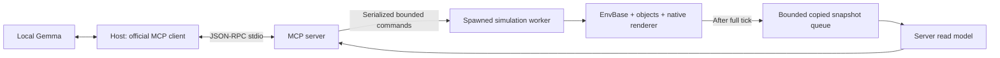

# Architecture, acceleration boundaries and consistency

[中文](architecture.zh-CN.md) · [Usage](README.md) · [Measured dispatch optimization](https://github.com/hanruihua/ir-sim/pull/386)

## Existing simulation contract

`irsim.make()` builds `EnvBase`, YAML configuration, `World`, object factories, kinematics/geometry handlers, behavior registries, sensors and an optional Matplotlib renderer. Object state arrays are mutable and object setters refresh dependent geometry/caches. `env.get_msg()` copies state and sensor arrays, but an arbitrary concurrent caller is not synchronized with a writer merely because copying occurs.

The normal step dispatches actions/group behavior, advances individual objects in their established order, rebuilds geometry indexing, solves contact where enabled, updates sensors, advances world time and checks status. Individual behaviors can observe neighbors already advanced earlier in the same step. The contact solver also depends on ordered sweeps. Replacing these with simultaneous array updates changes semantics even when the arithmetic looks equivalent.

## Separate performance and integration changes

| Layer | Change | Ownership and behavior |
| --- | --- | --- |
| Dispatch optimization | Neighbor-free declarations for built-in dash; per-call action identity maps | Existing objects remain authoritative; no physics or sensor order change |
| Optional MCP adapter | Dedicated simulation process, copied read model, versioned bounded command gateway | Legacy state stays in its owning worker; observers never receive live arrays |

The related [dispatch PR #386](https://github.com/hanruihua/ir-sim/pull/386) is independent of this integration. The measured 2.736× dash-1000 and 2.688× ID-action-1000 speedups belong to the dispatch change. They are not ECS, MCP, rendering or model-inference speedups. One/ten-object results are approximately unchanged. All 30 matched benchmark trajectories and final WorldState digests agreed. See the separate report for raw samples, TDD failures, environment and limitations.

## MCP process and state boundaries

`irsim_mcp` does not import the simulator in the protocol process. The spawned worker imports it only after redirecting diagnostics to stderr. One main thread owns the world and GUI, avoiding cross-environment parameter proxies and Matplotlib thread hazards. While Gemma thinks, the GUI event loop remains responsive and simulation time waits for commands. This is command-driven execution, not an independently running real-time plant.

After each completed tick the writer publishes an owned JSON-compatible observation. A queue bounded to two snapshots drops old telemetry when the reader is slow. Reads drain available telemetry and return deep copies. `publication_sequence` prevents delayed telemetry from replacing a newer completed-command receipt. Readers may skip frames and can observe an executing command; `command_in_progress`, frame, capture time and `age_seconds` make this visible. They never observe half of a kinematics/sensor/status update. There is no database, event store, or second writable ECS store in this change.

## Command consistency contract

- A blocking IPC lock serializes mutations and remains held even if an async tool handler is cancelled while its worker thread is still running.
- `expected_version` binds a command to the observed session, epoch and revision. Each tick/mutation progresses the revision. A queued command based on a moving world's older observation will be rejected after the preceding command completes.
- Validation precedes the first mutation. Missing robot/waypoint, invalid/Boolean step count, nonfinite coordinate, out-of-bounds goal and blocked navigation segment leave state unchanged.
- A goal change refreshes derived status and sensors without advancing the clock. Reset advances the epoch, preventing frame-zero observations from an earlier run from being accepted.
- A bounded 256-entry receipt cache prevents duplicate motion. Same ID with different command/arguments/version fails. Retrying an existing ID returns its outcome and the **current** state, rather than publishing an old frame.
- Cancellation is checked between ticks and reports actual completed steps. Collision ends the command early. Navigation arrival is derived from the simulator, not from the model's text.
- Unexpected simulator failure or an IPC timeout makes the session unavailable. The result of a partially executed command is unknown; restart/re-observe rather than automatically replaying it.

The read model covers the planar demo, including lidar valid masks. The core `WorldState` API is unchanged. MCP read-only/control modes concern the adapter; they do not alter arbitrary user code that separately holds a direct environment reference. Only trusted local YAML is accepted at startup; there is no tool for arbitrary Python execution, filesystem access or shell commands. The demo Host accepts only HTTP loopback model URLs.

## What can migrate safely next

| Candidate | Opportunity | Migration condition |
| --- | --- | --- |
| Copied state/observation arrays | Bulk export, analysis and render preparation | One writer, explicit complete-tick boundary, owned output buffers |
| Homogeneous pure kinematics | NumPy batch operations for selected omni/diff/dash populations | Opt-in batches; preserve formulas, clamping, angles, stop/arrival flags and RNG consumption; compare every tick |
| Candidate generation/geometry transforms | Batch transforms or broad-phase arrays | Keep Shapely precision/geometry validity and narrow-phase semantics; benchmark actual scenes |
| Neighbor-dependent individual behaviors | Potential batching | Preserve progressive live-neighbor visibility or introduce an explicit, separately versioned synchronous mode |
| Contact, custom plugins, heterogeneous/noisy models | High semantic risk | Keep the legacy path until differential tests cover order, side effects, RNG and cache invalidation |

The repository can migrate incrementally. An all-at-once conversion of authoritative storage and the physics schedule is not yet demonstrated safe. A later batch path should select compatible entities, compute into separate output buffers, commit through established state-update boundaries and fall back for unsupported components. Avoid two writable authorities and array views that outlive object deletion/reset.

Read/write separation mainly improves isolation, observability and scheduling flexibility. Its copy/serialization work has a cost. It does not by itself prove faster physics. Before enabling any ECS batch by default, benchmark full steps with sensors/collision/render options, require explicit differential tolerances, and measure small-scene regressions as well as large-scene speedups. Existing 30-run equality evidence protects the dispatch optimization only.

## Validation scope

Tests exercise real spawned environments and actual official-SDK stdio sessions, version rejection, deduplication, reset, bounds, collision, blocked navigation, concurrent complete-frame reads, cancellation and worker death. The live Gemma test is opt-in and separately executed. Its recorded mission proves this local controller/scene/model path; it does not establish general autonomous navigation reliability. Video is a native-window capture, while structured receipts establish the physical assertions. [Validation evidence](validation.json) records the outcomes and hashes.
