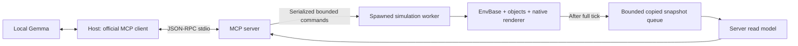

# MCP runtime architecture and consistency

[中文](architecture.zh-CN.md) · [Usage](README.md) · [Measured dispatch optimization](https://github.com/hanruihua/ir-sim/pull/386)

## Existing simulation contract

`irsim.make()` builds `EnvBase`, YAML configuration, `World`, object factories, kinematics/geometry handlers, behavior registries, sensors and an optional Matplotlib renderer. Object state arrays are mutable and object setters refresh dependent geometry/caches. `env.get_msg()` copies state and sensor arrays. The MCP worker captures these values at complete-tick boundaries to synchronize observations with writes.

The normal step dispatches actions/group behavior, advances individual objects in their established order, rebuilds geometry indexing, solves contact where enabled, updates sensors, advances world time and checks status. Individual behaviors can observe neighbors already advanced earlier in the same step. The contact solver also depends on ordered sweeps.

## MCP process and state boundaries

`irsim_mcp` does not import the simulator in the protocol process. The spawned worker imports it only after redirecting diagnostics to stderr. One main thread owns the world and GUI, avoiding cross-environment parameter proxies and Matplotlib thread hazards. Simulation time advances through MCP commands. The GUI event loop remains responsive while Gemma thinks.

After each completed tick the writer publishes an owned JSON-compatible observation. A queue bounded to two snapshots drops old telemetry when the reader is slow. Reads drain available telemetry and return deep copies. `publication_sequence` prevents delayed telemetry from replacing a newer completed-command receipt. Readers may skip frames and can observe an executing command; `command_in_progress`, frame, capture time and `age_seconds` make this visible. They never observe half of a kinematics/sensor/status update. The existing simulation objects remain the sole authoritative state.

## Command consistency contract

- A blocking IPC lock serializes mutations and remains held even if an async tool handler is cancelled while its worker thread is still running.
- `expected_version` binds a command to the observed session, epoch and revision. Each tick/mutation progresses the revision. A queued command based on a moving world's older observation will be rejected after the preceding command completes.
- Validation precedes the first mutation. Missing robot/waypoint, invalid/Boolean step count, nonfinite coordinate, out-of-bounds goal and blocked navigation segment leave state unchanged.
- A goal change refreshes derived status and sensors without advancing the clock. Reset advances the epoch, preventing frame-zero observations from an earlier run from being accepted.
- A bounded 256-entry receipt cache prevents duplicate motion. Same ID with different command/arguments/version fails. Retrying an existing ID returns its outcome and the **current** state, rather than publishing an old frame.
- Cancellation is checked between ticks and reports actual completed steps. Collision ends the command early. Navigation arrival is taken from the simulator's arrival flag.
- Unexpected simulator failure or an IPC timeout makes the session unavailable. The result of a partially executed command is unknown; restart/re-observe rather than automatically replaying it.

The read model covers the planar demo, including lidar valid masks. The core `WorldState` API is unchanged. MCP read-only/control modes concern the adapter; they do not alter arbitrary user code that separately holds a direct environment reference. Only trusted local YAML is accepted at startup; there is no tool for arbitrary Python execution, filesystem access or shell commands. The demo Host accepts only HTTP loopback model URLs.

## Validation scope

Tests exercise real spawned environments and actual official-SDK stdio sessions, version rejection, deduplication, reset, bounds, collision, blocked navigation, concurrent complete-frame reads, cancellation and worker death. The live Gemma test is opt-in and separately executed. The recorded mission uses one planar omni robot with dash control, lidar2d and static obstacles. Video is a native-window capture, while structured receipts establish the physical assertions. [Validation evidence](validation.json) records the outcomes and hashes.
