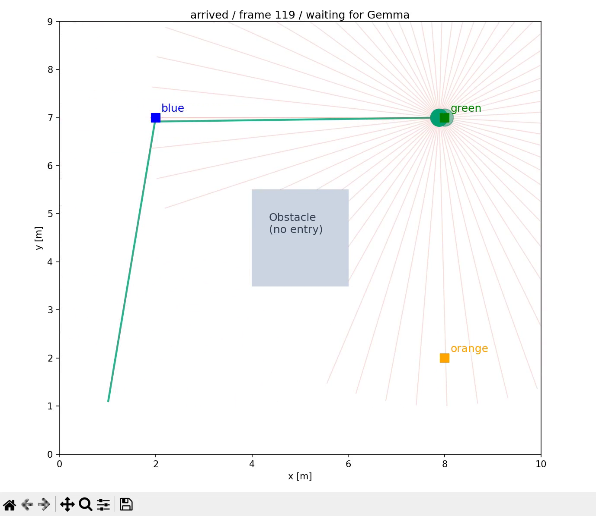

# 本地 Gemma + MCP 小机器人示例

[English](README.md) · [完整配置、工具说明与架构](../../docs/mcp/README.zh-CN.md)

在仓库根目录安装可选依赖，并启动支持原生工具调用与 reasoning parser 的本地 Gemma 服务：

```powershell
uv sync --locked --extra mcp --group test --group lint
.\.venv\Scripts\python.exe usage/27mcp_robot/demo.py --display --realtime --record-window --output artifacts/mcp-demo/my-run
```

默认地址 `http://127.0.0.1:8000/v1`，模型 `gemma-4-e2b-it`，任务先到 blue 再到 green。已验证的 vLLM 0.22.1 启动参数为 `--enable-auto-tool-choice --tool-call-parser gemma4 --reasoning-parser gemma4`，每轮请求均开启 `enable_thinking=true`。Windows 录像采集原生 Matplotlib 窗口，包括实际思考等待时间。不需要窗口时去掉 `--display --realtime --record-window`。

Gemma 原生调用工具选择路点，由官方 MCP 客户端转发，再由现有控制器移动机器人。灰色 **Obstacle / no entry** 矩形是有意设置的 2 × 2 米障碍，阻挡起点直达 green 的路线；机器人先走到 blue 的畅通路线。Host 没有生成路线。

提交的材料：[窗口录像](assets/gemma-thinking-window.mp4)、[终点窗口截图](assets/gemma-thinking-window.png)、[可移植 E2E 报告](assets/e2e-report.json)、[精简追踪日志](assets/trace.jsonl)。报告记录模型选择的命令、thinking 证据、实际访问顺序、碰撞状态、终点误差及视频完整性。


